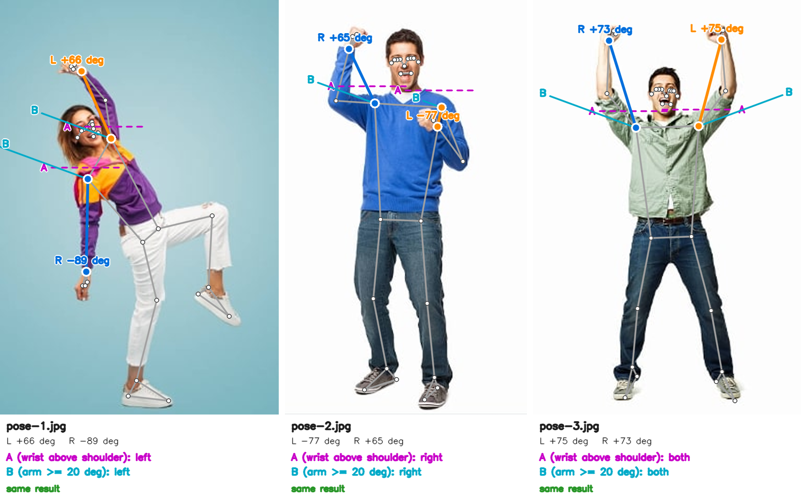
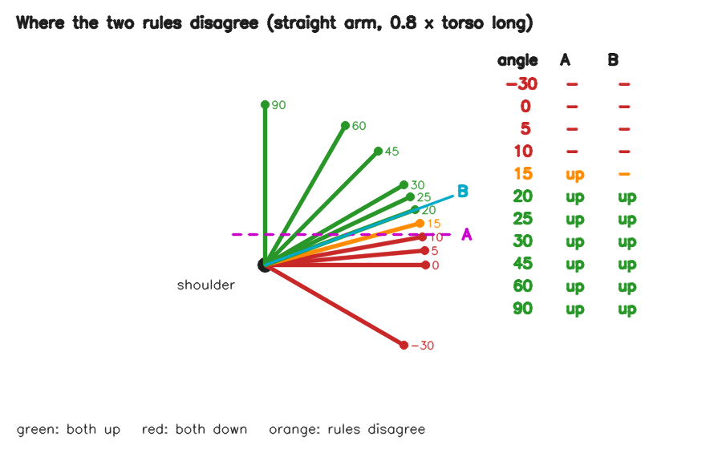

# Task 2: Which Arm Is Up?

Detects a person's body pose with [MediaPipe Pose Landmarker](https://ai.google.dev/edge/mediapipe/solutions/vision/pose_landmarker)
and says which arm is raised: `left`, `right`, `both` or `None`.

**Left and right are the person's own arms**, the way MediaPipe names them. A person facing the
camera who raises their left arm has it on the right side of the photo.

| Image | Result |
|---|---|
| `images/pose-1.jpg` | `left` |
| `images/pose-2.jpg` | `right` |
| `images/pose-3.jpg` | `both` |

## How it works

MediaPipe finds 33 body points (landmarks) in the image, each with an `x` and `y` between 0 and 1.
An arm counts as raised when its **wrist is clearly above its shoulder**. Image `y` grows downwards,
so "above" means a smaller `y`. "Clearly" means by at least 15% of the torso length (shoulders to
hips), so a fist held at shoulder height does not count. Points the model is unsure about
(visibility below 0.5) are ignored, and an image without a person gives `None`.

## Seeing the detection and comparing two rules

`visualize.py` draws the body points MediaPipe found and compares two ways of deciding when an
arm is raised:

- **A, margin rule (used):** the wrist is above the shoulder by 15% of the torso length.
- **B, angle rule:** the line from shoulder to wrist points at least 20° above horizontal.

Rule A is the one in use; `RULE = "angle"` in `arm_up.py` switches to rule B.

```bash
../.venv/bin/python visualize.py images/pose-1.jpg images/pose-2.jpg images/pose-3.jpg
```



Both rules give the same result on the three test images, because their arms are far above
(65–75°) or far below the shoulder. They only disagree for an arm a little above horizontal,
roughly between 11° and 20°. They can also disagree when a bent arm holds the hand just above
the shoulder: the height difference is too small for A, but the line points almost straight up for B.



## Run with Cog

Docker Desktop must be running and [Cog](https://github.com/replicate/cog) must be installed
(`brew install replicate/tap/cog`). The model is downloaded into the image while it is built.

```bash
cd Week-8/task-2
cog build -t arm-up
cog predict arm-up -i image=@images/pose-1.jpg
```

To try another image, replace the path after `image=@`.

## Run without a container

Tasks 2 and 3 share one virtual environment in `Week-8/.venv`.

```bash
cd Week-8
python3 -m venv .venv
.venv/bin/pip install -r task-2/requirements.txt
cd task-2
mkdir -p models
curl -L -o models/pose_landmarker_full.task https://storage.googleapis.com/mediapipe-models/pose_landmarker/pose_landmarker_full/float16/latest/pose_landmarker_full.task
../.venv/bin/python arm_up.py images/pose-1.jpg images/pose-2.jpg images/pose-3.jpg
```

## Files

| File | Role |
|---|---|
| `arm_up.py` | Finds the pose and decides which arm is up; also runs from the command line. |
| `run.py` | Cog's entry point: loads the model once and answers each image. |
| `visualize.py` | Draws the detected pose and compares the two rules; output in `visualizations/`. |
| `cog.yaml` | Tells Cog the Python version, the packages and how to download the model. |
| `requirements.txt` | The MediaPipe version. |
| `images/` | The three test images. |
