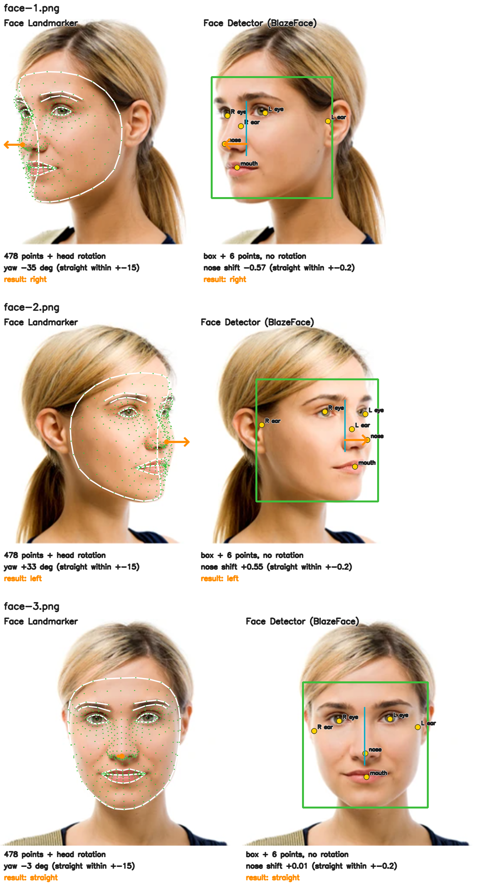

# Task 3: Which Way Is the Face Looking?

Detects a face with [MediaPipe Face Landmarker](https://ai.google.dev/edge/mediapipe/solutions/vision/face_landmarker)
and says which way it is looking: `left`, `right` or `straight`.

**Left and right are the person's own sides**, as in Task 2. A person who turns their head to
their left is looking towards the right side of the photo.

| Image | Head turn (yaw) | Result |
|---|---|---|
| `images/face-1.png` | −35° | `right` |
| `images/face-2.png` | +33° | `left` |
| `images/face-3.png` | −3° | `straight` |

## How it works

Besides 478 face points, MediaPipe returns the head's rotation as a 4×4 transformation matrix.
The script reads the **yaw** from it: how far the head is turned sideways, in degrees. Negative
means the person turned to their right, positive to their left. A turn of less than 15° in either
direction counts as `straight`.

## Comparison: the same task with the Face Detector (BlazeFace)

`face_direction_blazeface.py` solves the task with MediaPipe's simpler Face Detector, for
comparison only (Cog uses `face_direction.py`). BlazeFace gives a box and just 6 points, not the
head's rotation, so the direction comes from geometry: when the head turns, the nose tip moves
sideways from the middle of the eyes. The shift is divided by the eye distance and compared
with ±0.2.

| Image | Face Landmarker: yaw | Face Detector: nose shift | Both say |
|---|---|---|---|
| `face-1.png` | −35° | −0.57 | `right` |
| `face-2.png` | +33° | +0.55 | `left` |
| `face-3.png` | −3° | +0.01 | `straight` |

| | Face Landmarker (used) | Face Detector (BlazeFace) |
|---|---|---|
| Model size | 3.6 MB | 0.2 MB |
| Output | 478 points and the head's rotation matrix | a box and 6 points |
| Direction from | the yaw angle, in degrees | the nose's sideways shift, in eye distances |
| Threshold meaning | an angle (15°), easy to explain | a ratio (0.2), found from the test images |
| Weak spot | larger and slower | the ear points are guessed when an ear is hidden, so only eyes and nose are used; a tilted head can also move the nose |

```bash
../.venv/bin/python face_direction_blazeface.py images/face-1.png images/face-2.png images/face-3.png
```

`visualize.py` draws what each model finds and how each script decides, side by side:

```bash
../.venv/bin/python visualize.py images/face-1.png images/face-2.png images/face-3.png
```



On `face-1.png` the Face Detector puts its "R ear" point on the cheek: that ear is hidden, so the
model guesses. This is why the comparison script only uses the eyes and the nose.

## Run with Cog

Docker Desktop must be running and [Cog](https://github.com/replicate/cog) must be installed
(`brew install replicate/tap/cog`). The model is downloaded into the image while it is built.

```bash
cd Week-8/task-3
cog build -t face-direction
cog predict face-direction -i image=@images/face-1.png
```

To try another image, replace the path after `image=@`.

## Run without a container

Tasks 2 and 3 share one virtual environment in `Week-8/.venv`.

```bash
cd Week-8
python3 -m venv .venv
.venv/bin/pip install -r task-3/requirements.txt
cd task-3
mkdir -p models
curl -L -o models/face_landmarker.task https://storage.googleapis.com/mediapipe-models/face_landmarker/face_landmarker/float16/latest/face_landmarker.task
curl -L -o models/blaze_face_short_range.tflite https://storage.googleapis.com/mediapipe-models/face_detector/blaze_face_short_range/float16/latest/blaze_face_short_range.tflite   # only for the comparison script
../.venv/bin/python face_direction.py images/face-1.png images/face-2.png images/face-3.png
```

## Files

| File | Role |
|---|---|
| `face_direction.py` | Finds the face, reads the head's yaw and decides the direction; also runs from the command line. |
| `run.py` | Cog's entry point: loads the model once and answers each image. |
| `face_direction_blazeface.py` | The same task with the Face Detector (BlazeFace), for comparison. |
| `visualize.py` | Draws both methods side by side; output in `visualizations/`. |
| `cog.yaml` | Tells Cog the Python version, the packages and how to download the model. |
| `requirements.txt` | The MediaPipe version. |
| `images/` | The three test images. |
