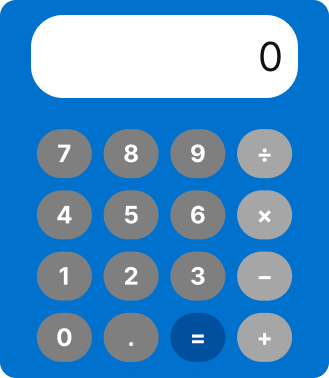

# Week 4 – Calculator and Library App

## Section 1: Calculator

Starting point: the `Calculator` class from Mini Project 1
([EE471_MP1_Calculator](https://github.com/ismail-kuru/EE471_MP1_Calculator)).

### Part 1: Figma design

- Figma (view only): https://www.figma.com/design/ChzHau46mB9TC91yU8ktHM/Untitled?node-id=1-3



### Part 2: Web calculator with a Flask backend

Code is in [`section1/`](section1/). All arithmetic runs in Python; the page never
uses `eval()` and does no math itself.

```bash
cd Week4
python3 -m venv .venv
.venv/bin/pip install -r section1/requirements.txt
cd section1
../.venv/bin/python app.py      # http://127.0.0.1:5001
```

`POST /api/calculate`

| | Body | Status |
|---|---|---|
| Request | `{"a": 10, "b": 5, "operation": "add"}` | |
| Success | `{"result": 15}` | 200 |
| Error | `{"error": "Cannot divide by zero."}` | 400 |

`operation` is one of `add`, `subtract`, `multiply`, `divide`. Invalid JSON, missing
fields, non-numeric operands, unknown operations and division by zero return 400.

```bash
curl -X POST http://127.0.0.1:5001/api/calculate \
     -H "Content-Type: application/json" \
     -d '{"a": 10, "b": 5, "operation": "add"}'
```

Prompts and corrections: [`section1/PROMPTS.md`](section1/PROMPTS.md).
